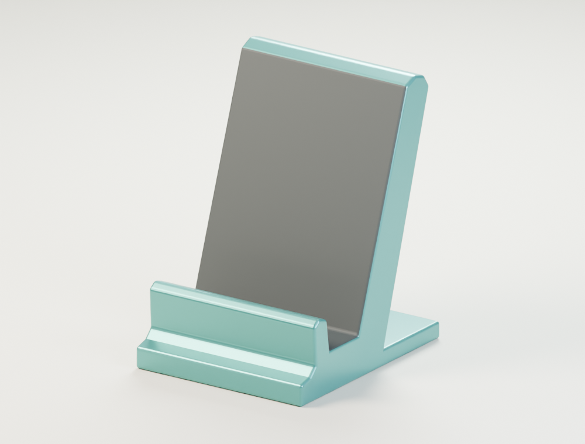

# Blender Production Skill

**Turn a brief into an editable Blender asset and an export you can verify.** Blender Production guides Codex and Claude Code through modeling, scene edits, renders, and export checks in Blender. Use it to work from a reference, repair an existing model, or prepare an asset for delivery.



The desk stand was built through MCP in Blender 5.2.2 LTS. The [example](examples/desk-stand/README.md) includes the editable scene, the GLB, and the round-trip results.

## Quick start

### 1. Connect Blender

Install [Blender](https://www.blender.org/download/) and follow [MCP for Blender’s setup guide](https://github.com/ahujasid/mcp-for-blender) for your agent. Launch Blender, open an empty scene or a disposable copy of your project, and start the server from the add-on panel. Confirm your agent can read the connected Blender version and scene before requesting edits. See [setup and connection checks](skills/blender-production/references/installation.md).

### 2. Install the skill

Use [GitHub CLI](https://cli.github.com/) with support for [`gh skill install`](https://cli.github.com/manual/gh_skill_install). Run the command for your agent.

```sh
# Codex
gh skill install Noraara/Blender-Production blender-production --agent codex --scope user

# Claude Code
gh skill install Noraara/Blender-Production blender-production --agent claude-code --scope user
```

For a project-only install, run from your project checkout with `--scope project`. For a local install, replace `Noraara/Blender-Production` with the path to this checkout and add `--from-local`. For manual setup, copy the entire [`skills/blender-production`](skills/blender-production) folder into the relevant directory.

| Agent | One project | All projects |
| --- | --- | --- |
| Codex | `.agents/skills/` | `~/.agents/skills/` |
| Claude Code | `.claude/skills/` | `~/.claude/skills/` |

### 3. Try a production task

Open a fresh session with Blender connected. Try this in Codex.

> Use $blender-production to model a small desk stand in my empty Blender scene. Save an editable Blender file, render a preview, and export a GLB. Reimport the GLB into a fresh scene and compare its dimensions and materials.

In Claude Code, start the request with `/blender-production`. Expect a source file, a preview, an export, and a report of the checks that ran. See the [desk stand brief and downloads](examples/desk-stand/README.md).

## How it works

| Stage | What the workflow checks |
| --- | --- |
| Inspect the brief and scene | Target object, scale, intended view, output formats, and any unsaved work. |
| Build or repair the asset | Silhouette and proportions first. Keep editable geometry and isolate the requested objects. |
| Review the result | Inspect a useful render or viewport view alongside mesh and material checks suited to the destination. |
| Deliver and verify | Save the source, export only the intended objects, and reopen or reimport in isolation. |

Blender and an MCP connection are the baseline for live edits. The [EL4CTEO](https://github.com/EL4CTEO/blender-skills) and [arjun988](https://github.com/arjun988/blender-skills) libraries offer optional specialist procedures for work such as advanced rigging, material bakes, and reference matching. Follow each author's install instructions for the workflows you use. See [how Blender Production selects specialists](skills/blender-production/references/specialists.md).

Related workflows can pass a brief or receive verification evidence through the [`atlas-workflow/v1` handoff](skills/blender-production/references/verification.md#handoff).

## Help and contributing

For an issue, include the Blender, agent, and MCP versions, the task or export format, and a small example you can share. Include the expected result and the first check that failed. For a workflow change, report the test you ran and the actual result.

## License

Released under the [MIT license](LICENSE).

## Credit

Made by [Noraara](https://github.com/Noraara).
