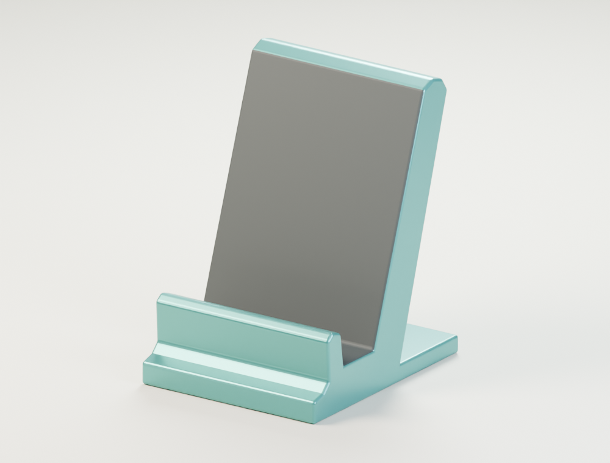

# Desk stand demo

This original desk stand shows the Blender Production workflow from a short brief to an editable source, a preview, and a verified GLB.

## Brief

Model a compact desk stand with a stable base, raised front lip, and angled contact surface. Use a roughly 88 mm wide body, a teal satin finish, and graphite where a device rests. Keep the edge treatment editable. Render it from a three-quarter view and export only the stand to GLB.

## Files

- [desk-stand.blend](desk-stand.blend) contains the editable profile mesh, bevel and normal modifiers, materials, and studio setup.
- [desk-stand.glb](desk-stand.glb) contains the evaluated stand mesh and its two materials.
- [desk-stand.png](desk-stand.png) is the studio render.

## Verification

Tested on Windows with Blender 5.2.2 LTS and MCP for Blender 2.1.9. The MCP session checked add-on and scene status, built the mesh, saved the editable scene, and exported the selected stand. The source reopened in Blender and rendered in background mode.

| Check | Observed result |
| --- | --- |
| Evaluated source mesh | 1,176 triangles, one connected mesh, two materials, and no open or nonmanifold edges. |
| Visual review | Inspected the hero render and side and three-quarter views in solid shading and wireframe. |
| Asset QA | The render QA profile reported zero mesh errors and warnings. UV checks were out of scope for the untextured materials. |
| GLB reimport | One mesh and two materials. Studio lights, camera, and backdrop stayed in the source scene. |
| Bounds and topology | 88 × 107 × 127.726 mm in both the evaluated source and the reimport. Triangle count and material names matched. |

These results cover the Blender round trip. Delivery to a specific engine adds its own import and runtime checks.
